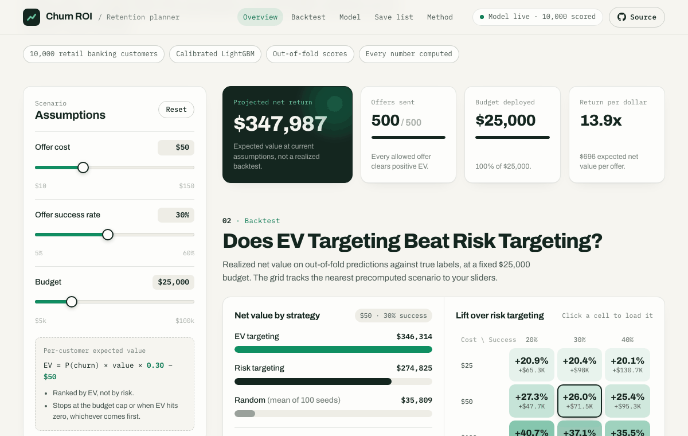
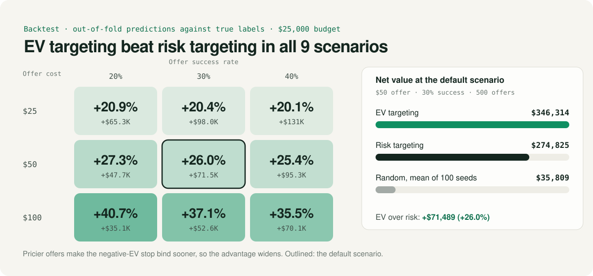
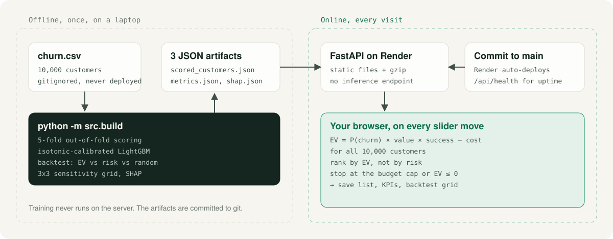
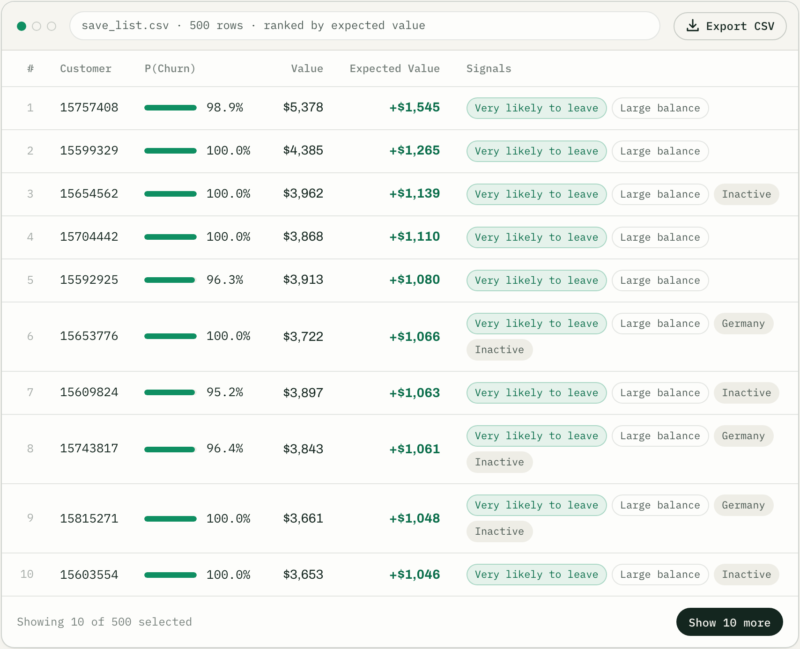

<p align="center"></p>

<p align="center">
  <a href="https://hansonyjy.github.io/churn-roi/"></a>
  
  
  
  
</p>

**A customer with a 95% chance of leaving can be the wrong one to save.**

Churn ROI scores 10,000 retail banking customers with a calibrated churn model, then decides, under a fixed retention budget, which of them are worth an offer and what the money should return. It ranks by expected value instead of risk, and it stops spending the moment the next offer would lose money, even with budget left over. Move the assumptions and all 10,000 customers re-rank in your browser.

I designed and built it end to end: the model, the decision engine, the backtest that grades it against true labels, and the app a retention manager would actually use. I build with Claude Code as a pair programmer, and the history shows how: small commits, each with its reason in the message.

**Live demo:** [hansonyjy.github.io/churn-roi](https://hansonyjy.github.io/churn-roi/). It is a static site on GitHub Pages, so there is no server to wake up.

## What You Can Do With It

- **Set the economics.** Offer cost, offer success rate and budget are sliders. Every move recomputes expected value for all 10,000 customers, re-ranks them and reapplies the stop, with no server round trip.
- **Watch the budget refuse to spend.** At a $10 offer and a $100,000 budget, the budget allows 10,000 offers but only 6,984 clear positive expected value. The app says so and holds back the remaining $30,160.
- **Check the backtest.** EV, risk and random targeting side by side, realized on true labels, plus the 3x3 sensitivity grid. Click any cell to load that scenario into the sliders.
- **Judge the model.** PR-AUC, ROC-AUC, Brier score, a calibration curve, a precision-recall curve and SHAP drivers, next to a logistic regression baseline.
- **Take the list.** The save list ranks who gets an offer, with churn probability, value, expected value and the signals behind each pick, and exports the full selection as CSV.

## The Headline Result

<p align="center"></p>

Most projects quote one flattering number. The honest version is a range: across a 3x3 grid of offer economics, EV targeting beat risk targeting by 20 to 41 percent in every cell, on real out-of-fold predictions against true labels. At the default scenario ($50 offer, 30% success), EV targeting returned $346,314 in realized net value against $274,825 for risk targeting and $35,809 for random targeting (mean over 100 seeds).

The pattern is itself a finding. As offers get more expensive, the negative-EV stop binds sooner and the advantage widens, which is why the $100 row shows the largest lift.

## How It Works

<p align="center"></p>

- **Every customer is scored by a model that never saw them.** Stratified 5-fold cross-validation fits an isotonically calibrated LightGBM on four folds and scores the held-out fifth. The save list and the backtest both cover the whole base, with no leakage.
- **Rank by expected value.** For each customer, `EV = P(churn) * value_saved * success_rate - offer_cost`. Sorting by EV instead of raw churn probability is the entire edge over a standard churn model.
- **The budget is a cap, not a quota.** Selection stops at `floor(budget / offer_cost)` offers or at the first customer whose EV is not positive, whichever comes first.
- **Training is offline, serving is static.** `python -m src.build` writes three JSON artifacts that are committed to git. GitHub Pages only hands out files, so there is no server and no inference on request: the demo loads fast, costs nothing to host and cannot fall over under load.

## What the Output Looks Like

The top of the save list at the default scenario. Every row is a customer worth more than the offer costs, ranked by what the offer is expected to return:

<p align="center"></p>

## Product Decisions

- **A ranked list with dollars, not a score.** A retention team acts on who to call and what it returns. AUC belongs in the model panel, not the headline.
- **Rank by EV, not risk.** A 95% risk customer who is worth little loses money on a $50 offer, while a 60% risk, high-value customer further down the list is a clearly positive bet.
- **Under-spending is a finding.** When the stop binds before the budget runs out, the app says so in plain words instead of quietly spending the rest.
- **Show the range, not the best cell.** The headline is the whole grid, including the scenario where the advantage is smallest (+20.1%).
- **The assumptions belong to the user.** Offer cost, success rate and budget are sliders because only the retention team knows them. Recomputing in the browser makes changing them free.
- **Readable on a phone.** Portfolio links get opened on phones, so the save list turns into cards below 640px and nothing scrolls sideways.

## Design Principles, and Why Each Exists

**1. Every number is computed, never typed.**
Metrics, the grid and the charts in this README all come from the committed artifacts. The two SVG figures are generated from `metrics.json` by `docs/figures.py`. *(A test asserts that EV targeting beats random on the real data, computed live rather than hardcoded.)*

**2. Calibrate before you multiply.**
You cannot multiply an uncalibrated probability by a dollar value and get a real number, so every score passes through isotonic calibration first. *(Brier score 0.103, and the calibration curve tracks the diagonal.)*

**3. No leakage, anywhere.**
The save list and the backtest use the same out-of-fold probabilities, so no customer is ever scored by a model that trained on them.

**4. A proxy must not decide the answer.**
`value_saved = 120 * num_products + 0.02 * balance`. *(36% of customers hold a zero balance. A pure balance proxy would value them at zero, EV targeting would ignore them by construction, and part of the measured lift would be an artifact of the proxy. The per-product term keeps them visible.)*

**5. Say what the model cannot do.**
This targets customers by churn probability, not persuadability. True incrementality needs uplift modeling and treatment data this dataset does not have, so the backtest states its simplification instead of claiming a causal effect.

## Model Notes

The calibrated LightGBM reaches PR-AUC 0.699 against a 0.204 no-skill baseline (the churn rate itself), ROC-AUC 0.861 and a Brier score of 0.103. The logistic regression baseline manages PR-AUC 0.464.

The tree model wins largely because NumOfProducts is sharply nonlinear: 2 products is the safest group at 7.6% churn, 3 products churns at 82.7% and 4 products at 100%, a shape no linear model can represent. SHAP on a plain LightGBM fit confirms the rest: Age is the strongest single driver, and Germany churns at roughly twice the rate of France and Spain.

## Assumptions, Stated Plainly

- **Value per product.** The $120 per product is an annual relationship value order of magnitude for retail banking (fees, interchange, cross-sell).
- **Balance margin.** The 2% is a net interest margin on deposits. Both figures are documented, configurable and meant as reasonable orders of magnitude, not exact.
- **Offer effect.** The backtest assumes an offer saves a would-be churner with probability equal to the success rate and does nothing for a non-churner. That is a stated simplification, not a claim of causal effect.

## Engineering Notes

- **Instant re-ranking.** Probabilities and values live in typed arrays, each slider move runs one stable sort, and dense input is coalesced to one recompute per frame. The first render runs synchronously, because browsers pause animation frames in background tabs.
- **One heavy file, compressed.** `scored_customers.json` is 1.3 MB of numeric text. GitHub Pages gzips it on the fly to under 180 KB.
- **No build step.** A GitHub Actions workflow publishes `app/static/` exactly as committed. The training stack (LightGBM, pandas, SHAP, scikit-learn) never leaves my laptop.
- **Cache-safe releases.** CSS and JS links carry a version query, so a browser holding the last release's files fetches the new ones as soon as it sees the new page. GitHub Pages caches pages for at most 10 minutes (`max-age=600`), so a release reaches every visitor within that window.
- **Deploys you can check.** Every push to `main` that touches `app/static/` runs the Pages workflow, and the Actions tab shows which commit is live. I moved here from Render's free tier, which made the first visit after a quiet spell wait about a minute, and where the live site once sat on its first commit for four months because Render's GitHub app had lost access to the repo.

## Repository Map

```
src/              data, OOF calibrated LightGBM, evaluation and SHAP, decision engine, build
app/main.py       optional FastAPI server for self-hosting, not used by the live demo
app/static/       the app: index.html, style.css (palette tokens), app.js (live recompute, charts)
app/static/data/  the three committed artifacts
tests/            EV math, budget cap, negative-EV exclusion, EV beats random on real data
docs/             README figures and the scripts that generate them
.github/          Pages workflow that publishes app/static/
render.yaml       Render blueprint for the optional self-hosted path
```

## About

Built by **Hanson Yang**: MSBA, UCLA Anderson (Dec 2026); B.Com Finance, UBC.

*Portfolio project on the public Churn_Modelling dataset. Customer values are documented proxies, not bank financials.*
